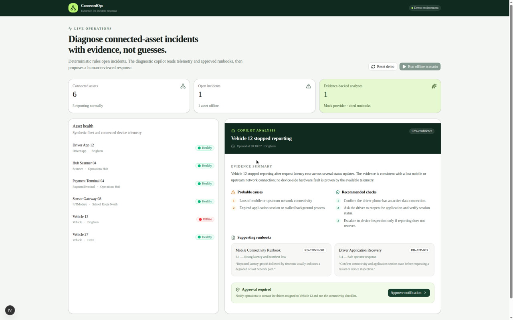
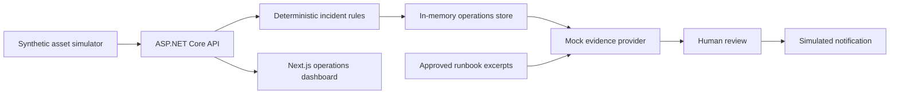

# Connected Operations Copilot

[](https://github.com/engmarconi/connected-operations-copilot/actions/workflows/ci.yml)

Evidence-based incident diagnostics for fleet and connected-device operations.

This public portfolio project demonstrates how deterministic operational systems can use AI safely: rules open incidents, approved evidence supports a diagnosis, and a person must approve every proposed action.

The repository uses synthetic data only. It contains no DrivoX, McShippers, iSmart Home, employer, or customer data.

## See it in action



## Working vertical slice

1. Six synthetic connected assets start healthy.
2. An operator runs the **Vehicle 12 offline** scenario.
3. The deterministic simulator records rising latency, timeouts, and heartbeat loss.
4. The incident engine opens a high-severity incident.
5. A deterministic mock diagnostic provider returns:
   - an evidence summary;
   - probable causes;
   - recommended checks;
   - citations to approved runbooks;
   - a confidence score.
6. The provider proposes an operator notification.
7. The notification is only simulated after explicit human approval.

The mock provider keeps the demo runnable without credentials. Real model providers, RAG storage, and evaluation suites are roadmap items rather than implied current capabilities.

## Architecture



## Technology

- ASP.NET Core / .NET 10
- Layered Domain, Application, Infrastructure, and API projects
- Next.js, TypeScript, Tailwind CSS, and shadcn/ui
- xUnit
- In-memory synthetic operations store
- Deterministic mock diagnostic provider

## Run locally

Requirements:

- .NET SDK 10
- Node.js 22+

Start the API:

```bash
dotnet run --project src/ConnectedOps.Api --urls http://127.0.0.1:5080
```

In a second terminal, start the dashboard:

```bash
cd web
cp .env.example .env.local
npm install
npm run dev -- --hostname 0.0.0.0 --port 43123
```

Open <http://127.0.0.1:43123>.

## Verify

```bash
dotnet build ConnectedOps.slnx
dotnet test ConnectedOps.slnx

cd web
npm run lint
npm run build
```

## Safety properties in the first slice

- Incident creation is deterministic, not model-controlled.
- The diagnostic provider has no direct database or device access.
- Every diagnosis cites named runbook sections.
- Proposed actions require explicit approval.
- Actions are simulated and auditable.
- The application runs without model credentials.

## Roadmap

- PostgreSQL and pgvector persistence
- Runbook ingestion and retrieval
- Schema-constrained Gemini and OpenAI providers
- Read-only tool calling
- Prompt-injection and missing-evidence tests
- Repeatable AI evaluation dataset
- OpenTelemetry traces, metrics, and structured logs
- Authentication and role-based approvals

## License

MIT
