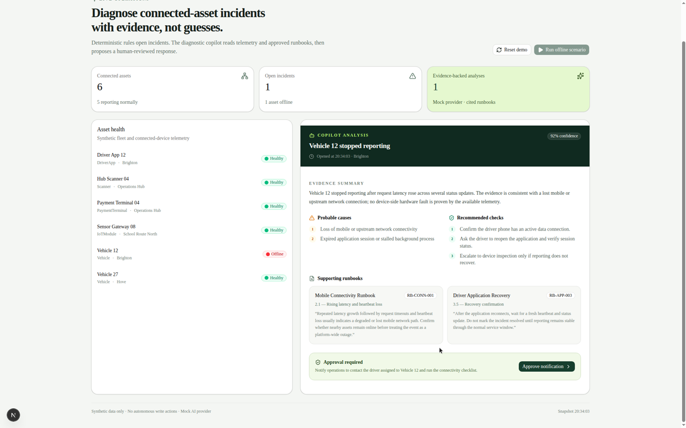
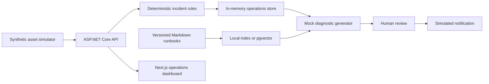

# Connected Operations Copilot

[](https://github.com/engmarconi/connected-operations-copilot/actions/workflows/ci.yml)

Evidence-based incident diagnostics for fleet and connected-device operations.

This public portfolio project demonstrates how deterministic operational systems can use AI safely: rules open incidents, versioned runbooks are retrieved as evidence, and a person must approve every proposed action.

The repository uses synthetic data only. It contains no DrivoX, McShippers, iSmart Home, employer, or customer data.

## See it in action



## Working vertical slice

1. Six synthetic connected assets start healthy.
2. An operator runs the **Vehicle 12 offline** scenario.
3. The deterministic simulator records rising latency, timeouts, and heartbeat loss.
4. The incident engine opens a high-severity incident.
5. The configured retrieval pipeline ranks versioned runbook sections against the incident telemetry.
6. A deterministic mock diagnostic provider returns:
   - an evidence summary;
   - probable causes;
   - recommended checks;
   - citations built from the retrieved runbook sections;
   - a confidence score.
7. The provider proposes an operator notification.
8. The notification is only simulated after explicit human approval.

The mock generator keeps the demo runnable without credentials. Retrieval supports two explicit modes: weighted local lexical ranking (the default), or PostgreSQL/pgvector similarity search using deterministic feature-hash embeddings. The feature hashes validate vector storage and retrieval architecture, but they are not presented as model-generated semantic embeddings.

## Architecture



## Technology

- ASP.NET Core / .NET 10
- Layered Domain, Application, Infrastructure, and API projects
- Next.js, TypeScript, Tailwind CSS, and shadcn/ui
- xUnit
- In-memory synthetic operations store
- Versioned Markdown runbook corpus
- Deterministic ingestion and weighted lexical retrieval
- Optional PostgreSQL 17 and pgvector retrieval
- Deterministic 256-dimension feature-hash embeddings
- Mock diagnostic generator with retrieved citations

## Retrieval pipeline

Runbooks under `runbooks/` are embedded into the backend at build time. The ingestion layer validates document metadata and chunks each document by section. Incident titles and telemetry become the retrieval query, with at most one section returned per document.

`IRunbookRetriever` keeps retrieval independent from diagnosis generation:

- **Local mode** builds an in-memory index and ranks weighted matches across keywords, titles, section names, and content.
- **pgvector mode** creates the vector extension, synchronizes the embedded corpus transactionally, stores normalized 256-dimension feature hashes, creates an HNSW cosine index, and performs nearest-neighbor retrieval.

`ITextEmbeddingService` is the replacement boundary for a future embedding model. The current feature hashing is deterministic, offline, and useful for validating the vector pipeline; it does not claim semantic understanding.

## Run locally

Requirements:

- .NET SDK 10
- Node.js 22+
- Docker (only for pgvector mode)

Start the API:

```bash
dotnet run --project src/ConnectedOps.Api --urls http://127.0.0.1:5080
```

In a second terminal, start the dashboard:

```bash
cd web
cp .env.example .env.local
npm install
npm run dev -- --hostname 0.0.0.0 --port 43123
```

Open <http://127.0.0.1:43123>.

### Run with pgvector

Start the database:

```bash
docker compose up -d pgvector
```

Set the backend configuration and start the API:

```bash
export RunbookRetrieval__Mode=pgvector
export ConnectionStrings__Runbooks='Host=127.0.0.1;Port=54329;Database=connectedops;Username=connectedops;Password=connectedops_dev'
dotnet run --project src/ConnectedOps.Api --urls http://127.0.0.1:5080
```

PowerShell:

```powershell
$env:RunbookRetrieval__Mode = "pgvector"
$env:ConnectionStrings__Runbooks = "Host=127.0.0.1;Port=54329;Database=connectedops;Username=connectedops;Password=connectedops_dev"
dotnet run --project src/ConnectedOps.Api --urls http://127.0.0.1:5080
```

The database credentials are local demo values from `compose.yaml`. Local retrieval remains the default when these settings are absent.

## Verify

```bash
dotnet build ConnectedOps.slnx
dotnet test ConnectedOps.slnx

cd web
npm run lint
npm run build
```

## Safety properties in the first slice

- Incident creation is deterministic, not model-controlled.
- The diagnostic provider has no direct database or device access.
- Diagnosis citations are created from retrieved, versioned runbook sections.
- Proposed actions require explicit approval.
- Actions are simulated and auditable.
- The application runs without model credentials.

## Roadmap

- Model-generated semantic embeddings behind `ITextEmbeddingService`
- Schema-constrained Gemini and OpenAI providers
- Read-only tool calling
- Prompt-injection and missing-evidence tests
- Repeatable AI evaluation dataset
- OpenTelemetry traces, metrics, and structured logs
- Authentication and role-based approvals

## License

MIT
