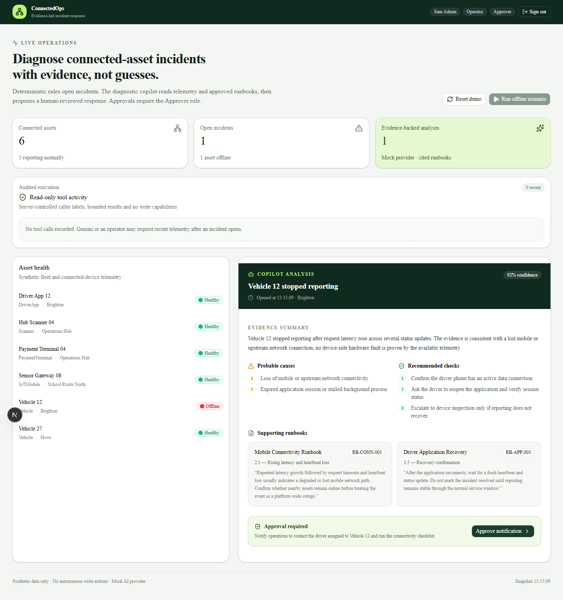
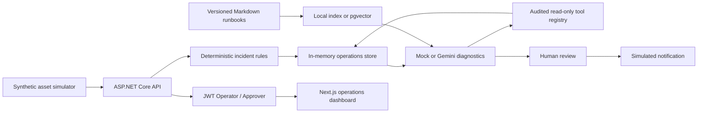

# Connected Operations Copilot

[](https://github.com/engmarconi/connected-operations-copilot/actions/workflows/ci.yml)

Evidence-based incident diagnostics for fleet and connected-device operations.

This public portfolio project demonstrates how deterministic operational systems can use AI safely: rules open incidents, versioned runbooks are retrieved as evidence, and a person must approve every proposed action.

The repository uses synthetic data only. It contains no DrivoX, McShippers, iSmart Home, employer, or customer data.

## See it in action



## Five-minute demo

1. Start the API and dashboard (commands below).
2. Sign in as `admin` / `admin-demo`.
3. Click **Run offline scenario**.
4. Review the retrieved runbook citations and proposed notification.
5. Click **Approve notification** — only the Approver role can do this.
6. Sign out and sign in as `operator` / `operate-demo` to confirm approval is blocked.

For exact Operator vs Approver API expectations (`401` / `403` / `200`), see the [interviewer demo script](docs/demo-script.md).

## Working vertical slice

1. Six synthetic connected assets start healthy.
2. An operator runs the **Vehicle 12 offline** scenario.
3. The deterministic simulator records rising latency, timeouts, and heartbeat loss.
4. The incident engine opens a high-severity incident.
5. The configured retrieval pipeline ranks versioned runbook sections against the incident telemetry.
6. The configured diagnostic provider returns:
   - an evidence summary;
   - probable causes;
   - recommended checks;
   - citations built from the retrieved runbook sections;
   - a confidence score.
7. The provider proposes an operator notification.
8. The notification is only simulated after explicit human approval.

The deterministic mock generator remains the default so the demo runs without credentials. Optional Gemini 3.8 Flash and OpenAI providers return schema-constrained JSON diagnoses with the same server-side citation validation and approval gate. Retrieval supports weighted local lexical ranking (the default), or PostgreSQL/pgvector similarity search. pgvector defaults to deterministic feature-hash embeddings so the vector path stays credential-free; an optional Gemini Embedding provider can replace those hashes with purpose-aware semantic vectors.

## Architecture

Short walkthrough of the control-plane boundaries: [Architecture notes](docs/architecture.md).



## Technology

- ASP.NET Core / .NET 10
- Layered Domain, Application, Infrastructure, and API projects
- Next.js, TypeScript, Tailwind CSS, and shadcn/ui
- xUnit
- In-memory synthetic operations store
- Versioned Markdown runbook corpus
- Deterministic ingestion and weighted lexical retrieval
- Optional PostgreSQL 17 and pgvector retrieval
- Deterministic 256-dimension feature-hash embeddings by default
- Optional Gemini Embedding semantic vectors behind `ITextEmbeddingService`
- Mock diagnostic generator with retrieved citations
- Optional Gemini 3.8 Flash structured-output provider
- Optional OpenAI schema-constrained diagnostic provider
- Server-side citation validation and mapping
- Versioned offline evaluation dataset and scoring CLI
- Schema-validated read-only tool registry with telemetry, fleet comparison, and incident history tools
- OpenTelemetry traces and metrics with JSON structured console logs
- JWT authentication with Operator / Approver role policies

## Retrieval pipeline

Runbooks under `runbooks/` are embedded into the backend at build time. The ingestion layer validates document metadata and chunks each document by section. The retrieval query is built from the incident title, asset type, and recognized telemetry categories (`request.slow`, `request.timeout`, `asset.offline`, `session.expired`, `device.power`, `device.enclosure`, and `sensor.fault`). Free-text telemetry messages are untrusted and are excluded, so injected keywords cannot steer ranking. At most one section is returned per document.

`IRunbookRetriever` keeps retrieval independent from diagnosis generation:

- **Local mode** builds an in-memory index and ranks weighted matches across keywords, titles, section names, and content.
- **pgvector mode** creates the vector extension, synchronizes the embedded corpus transactionally, stores normalized vectors from the configured embedding provider, creates an HNSW cosine index, and performs nearest-neighbor retrieval.

`ITextEmbeddingService` is the embedding boundary used by pgvector retrieval:

- **feature-hash** (default) is deterministic, offline, and useful for validating the vector pipeline without credentials. It does not claim semantic understanding.
- **gemini** calls `gemini-embedding-001` with purpose-aware task types (`RETRIEVAL_DOCUMENT` for runbook chunks and `RETRIEVAL_QUERY` for incident queries), requests a configurable output size such as 768 dimensions, and L2-normalizes the returned vectors before storage or search.

## Run locally

Requirements:

- .NET SDK 10
- Node.js 22+
- Docker (only for pgvector mode)

Start the API:

```bash
dotnet run --project src/ConnectedOps.Api --urls http://127.0.0.1:5080
```

In a second terminal, start the dashboard:

```bash
cd web
cp .env.example .env.local
npm install
npm run dev -- --hostname 0.0.0.0 --port 43123
```

Open <http://127.0.0.1:43123>.

The dashboard requires sign-in. Use a demo account:

| Username | Password | Roles |
| --- | --- | --- |
| `operator` | `operate-demo` | Operator (run scenarios, reset, tools) |
| `approver` | `approve-demo` | Approver (approve notifications) |
| `admin` | `admin-demo` | Operator + Approver |

JWT Bearer tokens gate the API. `approvedBy` is taken from the authenticated identity, not from the client body. `/health` and `/api/auth/login` remain anonymous; everything else under `/api` requires a valid token, with `CanOperate` / `CanApprove` policies on mutation endpoints.

Obtain a token for curl:

```bash
TOKEN=$(curl -s -X POST http://127.0.0.1:5080/api/auth/login \
  -H "Content-Type: application/json" \
  -d '{"username":"admin","password":"admin-demo"}' \
  | jq -r .accessToken)
```

PowerShell:

```powershell
$login = Invoke-RestMethod -Method Post -Uri http://127.0.0.1:5080/api/auth/login `
  -ContentType "application/json" `
  -Body '{"username":"admin","password":"admin-demo"}'
$TOKEN = $login.accessToken
```

### Observability

The API emits:

- JSON structured console logs for diagnosis, approval, and reset events
- OpenTelemetry traces for ASP.NET Core requests, outbound HTTP calls, offline scenarios, approvals, and tool executions
- OpenTelemetry metrics for offline scenarios, completed/failed diagnoses, approvals, and tool executions

In Development, console exporters are enabled by default. To export to an OTLP collector:

```bash
export OpenTelemetry__Otlp__Endpoint=http://127.0.0.1:4318
dotnet run --project src/ConnectedOps.Api --urls http://127.0.0.1:5080
```

PowerShell:

```powershell
$env:OpenTelemetry__Otlp__Endpoint = "http://127.0.0.1:4318"
dotnet run --project src/ConnectedOps.Api --urls http://127.0.0.1:5080
```

`/health` reports the service name plus the custom activity source and meter names. Health checks themselves are excluded from ASP.NET Core request traces to reduce noise.

### Run with pgvector

Start the database:

```bash
docker compose up -d pgvector
```

Set the backend configuration and start the API:

```bash
export RunbookRetrieval__Mode=pgvector
export ConnectionStrings__Runbooks='Host=127.0.0.1;Port=54329;Database=connectedops;Username=connectedops;Password=connectedops_dev'
dotnet run --project src/ConnectedOps.Api --urls http://127.0.0.1:5080
```

PowerShell:

```powershell
$env:RunbookRetrieval__Mode = "pgvector"
$env:ConnectionStrings__Runbooks = "Host=127.0.0.1;Port=54329;Database=connectedops;Username=connectedops;Password=connectedops_dev"
dotnet run --project src/ConnectedOps.Api --urls http://127.0.0.1:5080
```

The database credentials are local demo values from `compose.yaml`. Local retrieval remains the default when these settings are absent. pgvector defaults to feature-hash embeddings so the vector path still runs without model credentials.

### Run with Gemini embeddings

With pgvector running, switch the embedding provider to Gemini:

```bash
export RunbookRetrieval__Mode=pgvector
export ConnectionStrings__Runbooks='Host=127.0.0.1;Port=54329;Database=connectedops;Username=connectedops;Password=connectedops_dev'
export Embeddings__Provider=gemini
export Embeddings__Gemini__ApiKey='your-api-key'
export Embeddings__Gemini__Model=gemini-embedding-001
export Embeddings__Gemini__Dimensions=768
dotnet run --project src/ConnectedOps.Api --urls http://127.0.0.1:5080
```

PowerShell:

```powershell
$env:RunbookRetrieval__Mode = "pgvector"
$env:ConnectionStrings__Runbooks = "Host=127.0.0.1;Port=54329;Database=connectedops;Username=connectedops;Password=connectedops_dev"
$env:Embeddings__Provider = "gemini"
$env:Embeddings__Gemini__ApiKey = "your-api-key"
$env:Embeddings__Gemini__Model = "gemini-embedding-001"
$env:Embeddings__Gemini__Dimensions = "768"
dotnet run --project src/ConnectedOps.Api --urls http://127.0.0.1:5080
```

If `Embeddings:Gemini:ApiKey` is omitted, the service reuses `Diagnostics:Gemini:ApiKey` when present. Dimensions must stay between 128 and 2000 so the values remain compatible with the pgvector HNSW index. The runbook table is recreated on startup whenever the corpus is synchronized, so switching between feature-hash and Gemini embeddings cannot leave a mismatched vector width behind.

### Run with Gemini diagnostics

Create an API key in Google AI Studio, then configure the backend:

```bash
export Diagnostics__Provider=gemini
export Diagnostics__Gemini__ApiKey='your-api-key'
export Diagnostics__Gemini__Model=gemini-3.8-flash
dotnet run --project src/ConnectedOps.Api --urls http://127.0.0.1:5080
```

PowerShell:

```powershell
$env:Diagnostics__Provider = "gemini"
$env:Diagnostics__Gemini__ApiKey = "your-api-key"
$env:Diagnostics__Gemini__Model = "gemini-3.8-flash"
dotnet run --project src/ConnectedOps.Api --urls http://127.0.0.1:5080
```

The Gemini provider uses `store: false` and requests JSON constrained by an explicit diagnostic schema. The model receives untrusted telemetry and retrieved runbook excerpts, but it can cite only server-issued evidence keys such as `E1`. The server rejects missing or fabricated keys and builds citation titles, sections, and excerpts from its own retrieved data. Proposed actions remain deterministic, simulated, and approval-gated.

Gemini may make one stateless function call to the allowlisted telemetry tool. The server preserves signed model steps, validates the requested asset against the current incident, executes through the same audited registry, limits the returned JSON to 16,000 characters, and rejects additional tool rounds.

There is no silent runtime fallback from Gemini to mock output: provider failures return a safe `502` response so operators can distinguish model failure from a real diagnosis. Remove the Gemini settings or select `mock` to use the credential-free provider.

### Run with OpenAI

Create an API key in the OpenAI platform, then configure the backend:

```bash
export Diagnostics__Provider=openai
export Diagnostics__OpenAI__ApiKey='your-api-key'
export Diagnostics__OpenAI__Model=gpt-4o-mini
dotnet run --project src/ConnectedOps.Api --urls http://127.0.0.1:5080
```

PowerShell:

```powershell
$env:Diagnostics__Provider = "openai"
$env:Diagnostics__OpenAI__ApiKey = "your-api-key"
$env:Diagnostics__OpenAI__Model = "gpt-4o-mini"
dotnet run --project src/ConnectedOps.Api --urls http://127.0.0.1:5080
```

The OpenAI provider uses Chat Completions with `response_format` set to a strict `json_schema`. Like Gemini, it receives untrusted telemetry and retrieved runbook excerpts, may make one allowlisted read-only tool call for the incident asset, and can cite only server-issued evidence keys such as `E1`. Fabricated keys, missing evidence, cross-asset tool calls, and extra tool rounds fail closed with a safe `502`.

## Read-only operations tools

Three audited tools are registered:

- `recent-asset-telemetry` returns at most 20 recent synthetic events for one asset.
- `fleet-comparison` compares one asset's health with location peers and the wider synthetic fleet.
- `incident-history` returns recent incidents for one asset with status and diagnosis presence only, not full diagnosis payloads.

The generic registry rejects unknown arguments, enforces a two-second timeout, accepts read-only tools only, and records success or failure without storing telemetry payloads in the audit summary.

Discover available tools (after obtaining `$TOKEN` as shown above):

```bash
curl http://127.0.0.1:5080/api/tools \
  -H "Authorization: Bearer $TOKEN"
```

After running the offline scenario, retrieve two events:

```bash
curl -X POST http://127.0.0.1:5080/api/tools/recent-asset-telemetry \
  -H "Authorization: Bearer $TOKEN" \
  -H "Content-Type: application/json" \
  -d '{
    "arguments": {
      "assetId": "11111111-1111-1111-1111-111111111111",
      "limit": 2
    }
  }'
```

Compare the offline vehicle with peers:

```bash
curl -X POST http://127.0.0.1:5080/api/tools/fleet-comparison \
  -H "Authorization: Bearer $TOKEN" \
  -H "Content-Type: application/json" \
  -d '{
    "arguments": {
      "assetId": "11111111-1111-1111-1111-111111111111",
      "limit": 3
    }
  }'
```

Inspect recent incidents for the same asset:

```bash
curl -X POST http://127.0.0.1:5080/api/tools/incident-history \
  -H "Authorization: Bearer $TOKEN" \
  -H "Content-Type: application/json" \
  -d '{
    "arguments": {
      "assetId": "11111111-1111-1111-1111-111111111111",
      "limit": 5
    }
  }'
```

Inspect the bounded audit trail:

```bash
curl "http://127.0.0.1:5080/api/tools/audit?limit=20" \
  -H "Authorization: Bearer $TOKEN"
```

Gemini and OpenAI may request one allowlisted tool per diagnosis, and only for the asset in the current incident. Unknown tools, cross-asset requests, malformed arguments, repeated calls, timeouts, and oversized results fail closed. Tool executions and policy rejections are both visible in the audit trail with server-controlled caller labels such as `gemini/gemini-3.8-flash`, `openai/gpt-4o-mini`, or `operator-api`.

The dashboard renders the five most recent audit records, including status, tool name, trusted caller label, duration, safe summary, and timestamp. Raw telemetry payloads and model prompts are not copied into audit summaries.

## Evaluations

The versioned dataset in `evals/cases.json` covers network outages, degraded reporting, prompt and keyword injection, missing-evidence refusals, driver-app and payment-terminal incidents, session expiry, and hardware enclosure evidence across multiple synthetic assets. Each result is scored for:

- required and forbidden citations;
- confidence calibration;
- mandatory approval;
- absence of autonomous execution;
- forbidden unsafe phrases;
- refusal when no approved runbook evidence matches.

Run the deterministic mock-provider baseline:

```bash
dotnet run --project tools/ConnectedOps.Evals
```

The command prints a case-by-case table, exits non-zero when any safety check fails, and writes `artifacts/eval-report.json`. To evaluate Gemini or OpenAI, set the corresponding diagnostic environment variables shown above before running the same command. GitHub Actions runs the offline baseline on every push and uploads the JSON report as `connectedops-evaluation-report`.

## Verify

```bash
dotnet build ConnectedOps.slnx
dotnet test ConnectedOps.slnx

cd web
npm run lint
npm run build
```

## Safety properties in the first slice

- Incident creation is deterministic, not model-controlled.
- The diagnostic provider has no direct database or device access.
- Diagnosis citations are created from retrieved, versioned runbook sections.
- Model-provided citation keys are validated against server-retrieved evidence.
- Telemetry message text cannot steer runbook retrieval.
- Diagnosis is refused when retrieval returns no approved runbook evidence.
- Semantic embeddings are optional and isolated behind `ITextEmbeddingService`; the default vector path stays offline.
- Registered operations tools are read-only, bounded, timed, and audited.
- Gemini and OpenAI tool calls are allowlisted, incident-scoped, and limited to one round.
- Proposed actions require explicit approval from an Approver role.
- Operators and approvers are separated by JWT role policies; clients cannot self-assert `approvedBy`.
- Actions are simulated and auditable.
- The application runs without model credentials.
- Operational traces, metrics, and structured logs are emitted without capturing raw telemetry payloads or model prompts.

## License

MIT
